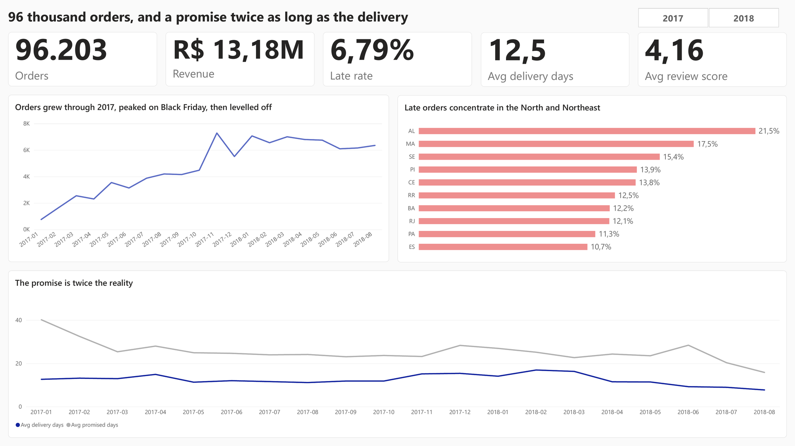
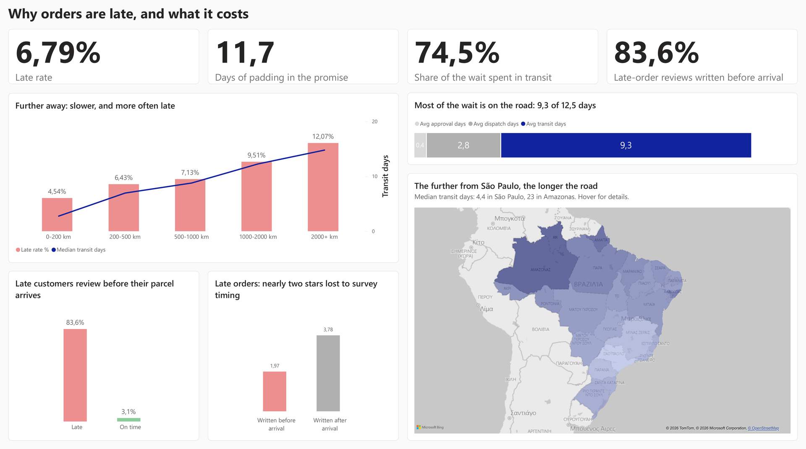
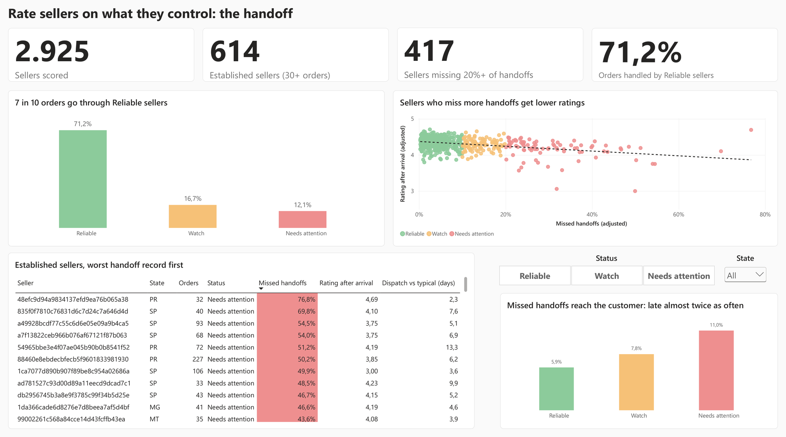

# Olist delivery audit

**Olist, a Brazilian e-commerce marketplace, reports that 6.79% of its orders arrive late. This project shows that the late rate mostly measures how generous the delivery promise is, not how well orders are delivered, and builds better measures in its place.**

96,203 delivered orders, January 2017 to August 2018 · SQL (DuckDB) · Python · Power BI



## At a glance

| | |
| --- | --- |
| **6.79%** | of orders arrive late, by Olist's own measure |
| **12 days** | how early the median order arrives before its promised date |
| **9.3 of 12.5 days** | of the average wait spent in transit with the carrier |
| **83.6%** | of reviews on late orders written before the parcel arrived |
| **88%** | of late orders caught by a simple route-based early warning, against 37% for a machine-learning model |
| **4×** | how much more likely an order is to be late when the seller misses the handoff deadline |

---

## The story

### 1. The starting hypothesis: São Paulo's sellers are the bottleneck

São Paulo sellers ship 70.4% of all orders. My first idea was that when their sales peak, they fall behind, and orders across the country arrive late.

**What I tested:**
- **Capacity.** Each seller's dispatch time in busy weeks, compared with that same seller's normal weeks.
- **Fairness.** Whether sellers push local orders ahead of distant ones.
- **Parcel size.** Whether big orders slow down the seller, the carrier, or both.

**What I found:** the hypothesis did not hold.
- São Paulo sellers handled up to two and a half times their usual weekly volume without slowing down, and over two years their dispatch time fell while volume grew tenfold.
- When orders bought around the same time are handed to the carrier out of sequence, local ones jump the queue no more often than distant ones.
- Larger parcels take sellers longer to pack (1.7 days rising to 3.0), but they do not travel any slower.

The sellers were not the problem, so I looked at the rest of the journey.

### 2. The delay is on the road

Splitting each order's wait into its stages shows where the time goes:

| Stage | Who controls it | Average days |
| --- | --- | --- |
| Payment approval | Payment provider | 0.4 |
| Dispatch | Seller | 2.8 |
| **Transit** | **Carrier** | **9.3** |
| **Total** | | **12.5** |

Transit is not just the largest stage, it is the one that drives lateness: it tracks the monthly late rate with a correlation of 0.78. And it grows with distance, from 2.0 days under 50 km to 14.8 days beyond 2,000 km. Customers buying from a seller in their own state receive their order in about three days; from São Paulo, about ten.



### 3. The surprise: if the road is this slow, why are only 6.8% of orders late?

Because the promise is padded. The median order arrives **12 days before its promised date**, and the late rate moves whenever the promise moves:

| Event | What happened to the promise | What happened to the late rate |
| --- | --- | --- |
| December 2017 holiday peak | Extended by five days | Fell by two fifths, while deliveries got slightly slower |
| May 2018 truckers' strike | Doubled within five days | Fell to 0.4% for the following week's orders |

These look like sensible responses to real risks, not manipulation. But they mean the late rate cannot be read as a measure of delivery performance.

### 4. What the late rate hides

- **Orders that never arrive.** 1,174 orders reached a carrier and were never delivered. They have no delivery date, so the late rate cannot see them. Counting them, the failure rate is 7.91% rather than 6.79%.
- **Unequal waiting times.** At the same distance, transit takes 6.9 days to the largest states and 12.5 days to the smallest, and freight costs 12 to 28% more. The late rate looks equal across the country only because the promise absorbs the difference.
- **Reviews of parcels that have not arrived.** Olist sends its review survey on the promised date, so when an order runs late, the customer is asked to rate something they do not have yet. 83.6% of reviews on late orders were written before delivery, against 3.3% on on-time orders. They average 1.97 stars, against 3.78 for late orders reviewed after arrival, and half of their comments say outright that the parcel has not arrived.

---

## What I built instead

### A route baseline: judging each order against its own route

For every route, the expected delivery time is calculated from that route's own recent history, using only data available at the time. Each order is then judged against its route rather than against the promise. This shows what the late rate misses:

- **2,351 orders in 2018 were slower than normal for their route, but on time.** The late rate counts them as fine. Customers did not: they rated them about 0.45 stars lower.
- **29% of late orders were normal for their route.** The delivery was not slow; the promise was too tight.


### An early warning for late orders

The same baseline works as an early warning: flag any order still in transit after 80% of its route's recent deliveries have already arrived. I compared it with a machine-learning model (logistic regression) that predicts lateness at the moment of purchase, flagging the same number of orders:

| | Route flag | Machine-learning model |
| --- | --- | --- |
| Orders flagged | 17.7% | 17.7% |
| Flagged orders that end up late | **38%** | 16% |
| Late orders caught | **88%** | 37% |
| Late orders caught before the deadline | **63%** | 37% (all flagged at purchase) |

The simple rule wins because lateness is mostly decided on the road, after the purchase. A model at purchase is predicting an event whose main cause has not happened yet. The flag gives a median of 3.4 days' warning, and its threshold can be moved to trade accuracy against warning time.

### A fair seller scorecard

Late rate and review score are the obvious ways to rate sellers, but both mostly measure things sellers do not control: the carrier and the survey timing. The scorecard rates sellers on the **handoff to the carrier** instead.

- **It is the part sellers control, and it matters:** missing the handoff deadline makes an order about four times more likely to be late.
- **It changes who gets flagged.** The worst 10% of sellers by late rate and by missed handoffs share only about a third of their members.
- **Rates are adjusted for evidence.** The median seller has only seven orders, so raw rankings are dominated by sellers with one or two unlucky orders. Each rate is weighed against how many orders stand behind it.
- **Ratings count only reviews written after delivery**, the reviews sellers actually earned.



---

## Recommendations

1. **Send the review survey when the parcel is delivered**, not on the promised date. Most bad reviews on late orders are about a parcel that has not arrived yet.
2. **Report delivery against each route's normal time** alongside the late rate, and count never-delivered orders as failures.
3. **Use the route baseline as an early warning** to keep customers informed about orders running late. Whether proactive updates improve satisfaction should be tested before rolling them out.
4. **Pad long routes by their uncertainty.** The promise adds roughly the same number of days on every route, while delivery uncertainty doubles with distance, so short routes are over-protected and long ones under-protected.
5. **Rate sellers on handoff reliability**, adjusted for evidence, using only reviews written after delivery.

---

## Dashboard

Four Power BI pages, each answering one question. Every chart title states its finding, and colour carries the same meaning throughout: red for late, green for on time, grey for context and navy for the highlight.

| Page | Question | Interaction |
| --- | --- | --- |
| Overview | How far apart are the promise and the reality? | Year filter |
| Delivery | Why are orders late? | Click a state on the map to filter the page |
| Slower than normal | What changes when each order is judged against its own route? | |
| Sellers | Which sellers need attention, rated on what they control? | Status and state filters |

The full dashboard is also available as a [PDF](dashboard/dashboard.pdf). The *Slower than normal* page covers July 2017 to August 2018, while notebook 06 evaluates on 2018 orders only, so some of its figures differ from those quoted above. The seller scorecard is a precomputed model output and is not filtered by date.

---

## How it was built

### Notebooks

The notebooks follow the order in which things were discovered. The hypothesis that turned out wrong is kept in place, because the way it failed is what led to everything after it.

| Notebook | Content |
| --- | --- |
| [01 Data loading](notebooks/01_data_loading.ipynb) | Loads the nine source files unchanged and establishes what one row means in each |
| [02 Data cleaning](notebooks/02_data_cleaning.ipynb) | Cleans each table and documents the data issues that change the analysis |
| [03 Data model](notebooks/03_data_model.ipynb) | Builds the star schema and exports it for Power BI |
| [04 Delivery analysis](notebooks/04_delivery_analysis.ipynb) | Story steps 1 to 4: the hypothesis, the road and the promise |
| [05 Network analysis](notebooks/05_network_analysis.ipynb) | Waiting times and freight by state size |
| [06 Promise and early warning](notebooks/06_promise_and_early_warning.ipynb) | The route baseline, the early warning and the machine-learning comparison |
| [07 Seller scorecard](notebooks/07_seller_scorecard.ipynb) | The fair seller scorecard |

### Data model

The data moves through three layers in DuckDB: `raw` (the source files, never modified), `clean` (one cleaned table per source file) and `model` (a star schema).

| Table | One row per |
| --- | --- |
| `fct_orders` | delivered order: delivery stages, promise, review, route baseline |
| `fct_order_items` | item on a delivered order: price, freight, product, seller |
| `dim_date`, `dim_customer`, `dim_seller`, `dim_product`, `dim_route` | shared dimensions |
| `seller_scorecard` | seller: handoff reliability, rating and dispatch speed |

Orders and items have separate fact tables because delivery happens once per order and price once per item. Joining them would repeat each order's delivery time once per item and silently weight averages by basket size.

### Data issues that shaped the analysis

- **The promised date has no time of day.** Comparing it with real delivery timestamps counts 1,292 same-day deliveries as late (8.11% instead of 6.77%), so the promise is measured in whole days.
- **Review timing.** Because most reviews on late orders predate delivery, every review figure is split by whether it came before or after arrival.
- **1,382 orders have timestamps in an impossible order**, mostly carrier pickup recorded before payment approval. They are flagged and excluded only where they would distort durations.
- **Two revenue figures disagree by 165,319 BRL.** The gap is fully reconciled, mostly to paid orders that were never fulfilled and to credit-card instalment interest.

### Methods

| Method | Used for |
| --- | --- |
| Within-seller comparisons | Testing capacity and fairness against each seller's own normal |
| Seller-clustered bootstrap | Significance tests that do not treat orders from the same seller as independent |
| Event study | The effect of the 2018 truckers' strike on the promise and the late rate |
| Direct standardisation | Comparing states at the same mix of distances |
| Rolling route percentiles | The route baseline and early warning, using only past data |
| Logistic regression, time-based split | The machine-learning benchmark |
| Empirical Bayes shrinkage | Seller rates adjusted for how many orders stand behind them |

### Limitations

- The data is observational, so the findings describe associations. The review-timing effect is the most direct, because it follows from when the survey was sent.
- The dataset does not identify carriers, so the carrier network can only be studied through routes and distances.
- Distances are straight lines between zip-code centroids, not road distances.
- The seller scorecard covers single-seller orders (98.7% of all orders).

---

## Repository structure

```
├── README.md
├── requirements.txt
├── data/                  the nine Kaggle CSV files (not included, see below)
├── notebooks/             01 to 07
├── outputs/model/         tables exported for Power BI (created by the notebooks)
├── dashboard/
│   ├── olist_dashboard.pbix
│   ├── olist_theme.json   the report's colour palette and text styles
│   └── dashboard.pdf
└── images/                dashboard pages shown in this README
```

## How to run it

1. Download the [Brazilian E-Commerce Public Dataset by Olist](https://www.kaggle.com/datasets/olistbr/brazilian-ecommerce) from Kaggle and place the nine CSV files in `data/`.
2. Install the requirements (Python 3.11 or later): `pip install -r requirements.txt`
3. Run the notebooks in order from the `notebooks/` folder. They build `olist.duckdb` and write the Power BI tables to `outputs/model/`.
4. Open `dashboard/olist_dashboard.pbix` in Power BI Desktop. The data is stored in the file.

## Tools

DuckDB (SQL) · Python (pandas, NumPy, statsmodels, scikit-learn, Matplotlib) · Jupyter · Power BI (Power Query, DAX)
