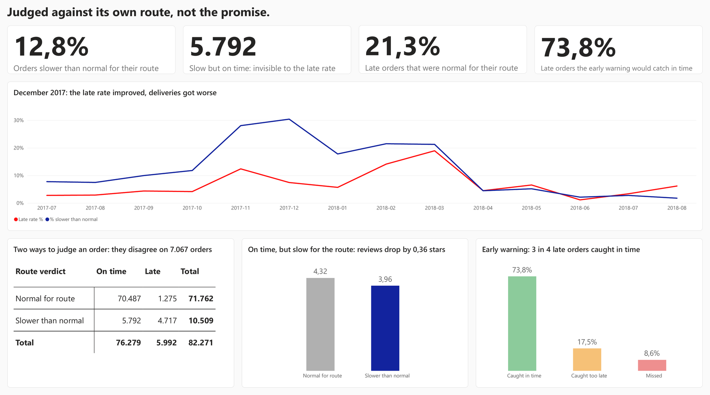

# Olist delivery audit: the late rate measures the promise, not the service

An end-to-end analysis of 96,203 orders from Olist, a Brazilian e-commerce marketplace, built with SQL (DuckDB), Python and Power BI.

Olist reports that 6.79% of its orders arrive late. This project asks why, and finds that the late rate mostly reflects how generous the delivery promise is, not how well orders are delivered. It then builds better measures: a route-based definition of "slow", an early warning for late orders, and a fair way to rate sellers.


---

## Key findings

**1. The late rate moves with the promise.**
The median order arrives 12 days before its promised date. When Olist extended the promise by five days in December 2017, the late rate fell by two fifths while deliveries got slightly slower. During the 2018 truckers' strike, the promise doubled within five days and the late rate for the following week fell to 0.4%. The late rate also leaves out the 1,174 orders that reached a carrier and never arrived: counting them, the failure rate is 7.91% rather than 6.79%.

**2. The bottleneck is the road, not the seller.**
Transit accounts for 9.3 of the 12.5 days an average order takes, and it tracks monthly lateness with a correlation of 0.78. It rises from 2.0 days under 50 km to 14.8 days beyond 2,000 km. São Paulo sellers, who ship 70.4% of all orders, absorb up to two and a half times their normal weekly volume without slowing down, and they do not push local orders ahead of distant ones.

**3. Most bad reviews on late orders are written before the parcel arrives.**
83.6% of reviews on late orders were written before delivery, because Olist sends the review survey on the estimated delivery date. Those reviews average 1.97 stars; late orders reviewed after arrival average 3.78. Half of the early comments say outright that the order has not arrived.

**4. Customers in smaller states wait longer for the same journey, and pay more.**
At equal distance, transit takes 6.9 days for customers in the largest states and 12.5 days in the smallest (excluding Brasília). Freight is 18% higher for medium-sized states and 12 to 28% higher for the smallest. The late rate looks equal across the country only because the promise absorbs the difference.

**5. Judging each order against its own route reveals what the late rate cannot.**
In 2018, 2,351 orders were slower than normal for their route but still on time, and customers rated them about 0.45 stars lower. Another 29% of late orders were normal for their route: the promise was too tight, not the delivery too slow.

**6. A simple route baseline beats a machine-learning model as an early warning.**
Flagging orders still in transit past the 80th percentile of their route catches 88% of late orders, 63% of them before the deadline with a median of 3.4 days' warning, and 38% of flagged orders end up late. A logistic regression predicting lateness at purchase (AUC 0.68) catches only 37% at 16% precision, because lateness is mostly decided in transit, after the purchase.

**7. Sellers should be rated on the handoff, the part of the job they control.**
Missing the handoff deadline makes an order about four times more likely to be late. Ranking sellers by late rate instead flags a largely different group: the worst 10% by each measure share only about a third of their members.

## Recommendations

1. **Send the review request when the parcel is delivered**, not on the estimated date. This is directly supported by the data and costs nothing.
2. **Report service against each route's normal delivery time** alongside the late rate, and count never-delivered orders as failures.
3. **Use the route baseline as an early warning** and respond with information, such as a proactive status update. Discounts are not supported: only 3.1% of customers ever order twice, and a late first order lowers that by half a percentage point at most. Warning customers in advance is promising but should be tested first.
4. **Pad long routes by their uncertainty.** The promise adds roughly the same number of days to every distance band, while delivery uncertainty doubles with distance.
5. **Rate sellers on handoff reliability**, adjusted for how many orders stand behind each rate, and count only reviews written after delivery.

---

## Dashboard

Four Power BI pages, each making one point. Every chart title states its finding, and colour carries meaning throughout: red for late, green for on time, grey for context and navy for the highlight.

| Page | Question it answers |
| --- | --- |
| **Overview** | What does the business look like, and how far apart are the promise and reality? |
| **Delivery** | Why are orders late? Distance, transit and the timing of the review survey. Click a state on the map to filter the page. |
| **Slower than normal** | What changes when each order is judged against its own route instead of the promise? |
| **Sellers** | Which sellers need attention, rated on what they control? Filter by status and state. |





The *Slower than normal* page covers every order with a route baseline (July 2017 to August 2018), while notebook 06 evaluates its methods on 2018 orders only, so the dashboard's figures differ somewhat from those quoted above. The seller scorecard is a precomputed model output and is deliberately not filtered by date.

The full dashboard is also available as [dashboard/dashboard.pdf](dashboard/dashboard.pdf) for anyone without Power BI.

---

## How the analysis was done

The notebooks follow the order in which things were actually discovered. Early hypotheses that the data did not support are kept in place, because the way they failed is what led to the later results.

| Notebook | What it does |
| --- | --- |
| [01 Data loading](notebooks/01_data_loading.ipynb) | Loads the nine source files unchanged and establishes what one row means in each. |
| [02 Data cleaning](notebooks/02_data_cleaning.ipynb) | Cleans each table and records five findings that change how the data must be analysed. |
| [03 Data model](notebooks/03_data_model.ipynb) | Builds a star schema and exports it for Power BI. |
| [04 Delivery analysis](notebooks/04_delivery_analysis.ipynb) | Tests where the bottleneck is: seller capacity, seller fairness, parcel size or the carrier network. |
| [05 Network analysis](notebooks/05_network_analysis.ipynb) | Treats states as a network and asks whether large states serve smaller ones worse. |
| [06 Promise and early warning](notebooks/06_promise_and_early_warning.ipynb) | Builds an expected delivery time per route, an early-warning flag, and compares it with a machine-learning model. |
| [07 Seller scorecard](notebooks/07_seller_scorecard.ipynb) | Rates sellers fairly on what they control and exports the scorecard. |

### Data model

The data moves through three layers in DuckDB: `raw` (the source files, never modified), `clean` (one cleaned table per source file) and `model` (a star schema).

| Table | Grain |
| --- | --- |
| `fct_orders` | one delivered order: delivery times, promise, review, route baseline |
| `fct_order_items` | one item on a delivered order: price, freight, product, seller |
| `dim_date`, `dim_customer`, `dim_seller`, `dim_product`, `dim_route` | conformed dimensions shared by both fact tables |
| `seller_scorecard` | one seller: handoff reliability, rating and dispatch speed, adjusted for evidence |

Delivery and revenue live at different grains, so they have separate fact tables. Joining them would repeat each order's delivery time once per item and silently weight averages by basket size.

### What the cleaning found

- **The promised date has no time of day.** Comparing it with real delivery timestamps counts 1,292 same-day deliveries as late (8.11% instead of 6.77%), so the promise is measured in whole days.
- **Review timing.** Most reviews on late orders predate delivery, so every review figure is split by whether the review came before or after arrival.
- **1,382 orders have timestamps in an impossible order**, mostly carrier pickup before payment approval. They are flagged and excluded only where they would distort durations.
- **Two revenue figures disagree by 165,319 BRL.** The gap is fully reconciled, mostly to paid orders that were never fulfilled and to credit-card instalment interest.

### Methods

- **Direct standardisation** to compare late rates across state sizes at the same mix of distances.
- **Event study** around the May 2018 truckers' strike.
- **Seller-clustered bootstrap** for the capacity test, so that orders from the same seller are not treated as independent.
- **Within-seller comparisons** and a queue-order (first in, first out) test for seller fairness.
- **Rolling route percentiles** with no look-ahead, as the expected delivery time and early-warning threshold.
- **Logistic regression with a temporal train/test split** as the machine-learning benchmark.
- **Empirical Bayes shrinkage** (beta-binomial for rates, normal-normal for means) so that sellers with few orders are not ranked on noise.

### Limitations

- The data is observational, so the findings describe associations. The review-timing effect is the most direct, because it follows from when the survey was sent.
- The dataset does not identify carriers, so the carrier network can only be studied through routes and distances.
- Distances are straight lines between zip-code centroids, not road distances.
- The seller scorecard covers single-seller orders (98.7% of orders), because an order with two sellers has one handoff and one review that cannot be split.
- 2016 is excluded because its monthly series is not continuous.

---

## Repository structure

```
├── README.md
├── requirements.txt
├── data/                  the nine Kaggle CSV files (not included, see below)
├── notebooks/             01 to 07
├── outputs/model/         tables exported for Power BI (created by the notebooks)
├── dashboard/
│   ├── olist_dashboard.pbix
│   ├── olist_theme.json   the report's colour palette and text styles
│   └── dashboard.pdf
└── images/                dashboard pages shown in this README
```

## How to run it

1. Download the [Brazilian E-Commerce Public Dataset by Olist](https://www.kaggle.com/datasets/olistbr/brazilian-ecommerce) from Kaggle and place the nine CSV files in `data/`.
2. Install the requirements (Python 3.11 or later):
   ```
   pip install -r requirements.txt
   ```
3. Run the notebooks in order from the `notebooks/` folder. Notebooks 01 to 03 build `olist.duckdb`; notebooks 03, 06 and 07 write the tables in `outputs/model/`.
4. Open `dashboard/olist_dashboard.pbix` in Power BI Desktop. The data is already stored in the file. To refresh it from your own run, point the Power Query source folder at your `outputs/model/` folder.

## Tools

DuckDB (SQL), Python (pandas, NumPy, statsmodels, scikit-learn, Matplotlib), Jupyter, Power BI (Power Query, DAX).
